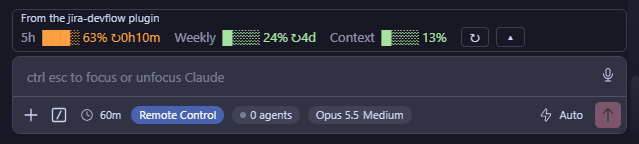
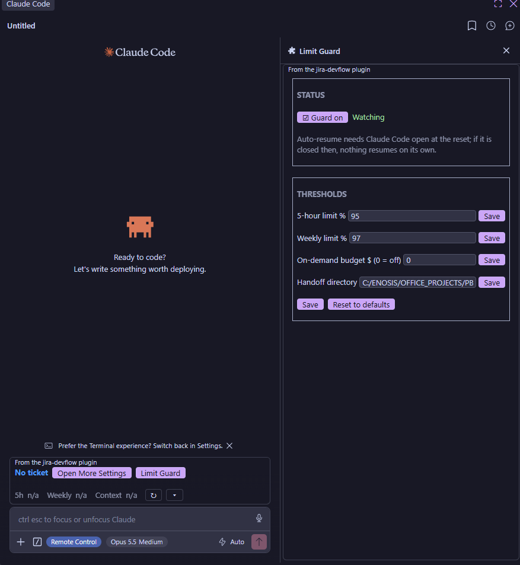
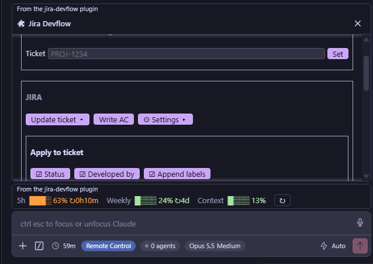

# jira-devflow

A Claude Code mod that helps you stay within your usage limits. It shows your limits above the prompt box, and it can pause Claude before a limit runs out, then pick the work back up once the limit resets. It also has optional Jira and git shortcuts.

## Features at a glance

| Feature | Where | What it does |
| --- | --- | --- |
| **Usage ribbon** | Above the prompt box, always | Live 5-hour, weekly and context meters, colour-coded by how close you are to the limit, with the time until each resets. |
| **Limit Guard** | **Limit Guard** button on the ribbon | Pauses Claude at a threshold you set (5-hour, weekly or an on-demand budget), saves a handoff doc, and resumes from it after the limit resets. |
| **Dev settings panel** | **Open More Settings** on the ribbon, or `/devflow` | Optional Jira and git shortcuts: update a ticket, write acceptance criteria, save plans, commit messages, AI review. |

## Usage ribbon



A row above the prompt box, shown in every session:

- **5h**, **Weekly** and **Context** meters, each with a bar, the percentage used and the time until it resets (e.g. `↻2h14m`).
- Bars are green below 60%, orange from 60% and red from 90%.
- Refreshes every 30 seconds and after every turn. **↻** refreshes it now.
- **▴ / ▾** shows or hides the second row, which has the current ticket and the **Open More Settings** and **Limit Guard** buttons.
- In a narrow window the bars get shorter.

## Limit Guard



Stops a long task before it runs into the limit and continues it after the reset, so nothing is lost and no on-demand usage is spent unless you allow it.

**What happens when a threshold is reached**

1. Claude's current turn is stopped.
2. Claude writes a handoff doc: the goal, what's done, exactly where it stopped, next steps, key files and decisions, and open questions. It's saved as `handoff-<TICKET>-<date-time>.md` in the handoff directory.
3. The session is paused: tool calls are refused, new turns are stopped and typed prompts are held back. Slash commands still work. The ribbon button changes to **Limit Guard ⏸**.
4. One minute after the limit resets, the handoff doc is sent back to Claude and the work carries on from where it stopped.

**Settings** (shared by every session, since the limits are account-wide; a change reaches other running sessions on their next usage update. Only the handoff directory is kept per repo or worktree. Defaults are filled into the fields.)

| Setting | Default | Meaning |
| --- | --- | --- |
| Guard on | On | Turns the guard on or off. |
| 5-hour limit % | 95 | Pause when the 5-hour window reaches this. |
| Weekly limit % | 97 | Pause when the weekly window reaches this. |
| On-demand budget $ | 0 (off) | How much on-demand usage Claude may spend after a limit is fully used. |
| Pause by | % limits | Shown when the budget is above $0. **% limits**: the thresholds above pause Claude and nothing is spent on-demand. **On-demand budget**: Claude can go past 100% and pauses once it has spent the budget. |
| Handoff directory | `<repo>/.claude/handoffs` | Where handoff docs are saved. Created when needed. |

**Buttons:** **Save**, **Reset to defaults**, and **Resume now** while paused. Resume now continues straight away and stops checking that limit until it resets.

**Good to know**

- Usage is read after each reply from Claude, so a pause can land a point or two past the threshold.
- Writing the handoff doc uses one more request.
- Auto-resume needs Claude Code to be open when the limit resets. If it's closed, nothing resumes on its own; the handoff doc stays in the handoff directory.
- Handoff docs are never deleted.

## Dev settings panel



Optional, for Jira-based work. Opens with **Open More Settings** or `/devflow`; it stays hidden until then.

| Section | What it does |
| --- | --- |
| Ticket | Picks up a ticket key (e.g. `PROJ-1234`) from your prompt, or set it by hand. |
| Update ticket | Sets the status, Developed by and extra labels through the Atlassian connector. Pick which parts to apply. |
| Write AC | Writes acceptance criteria for the ticket with the bundled skill and adds them to Jira. |
| Settings | Your Jira email and a connector check. |
| Plan | Saves an approved plan as `<TICKET>-<name>.md`; can also post it as a Jira comment. |
| Findings | After a turn that analysed without editing files, posts Claude's answer as a Jira comment. |
| Commit | After Claude edits files: lists them and writes a commit message that follows your CLAUDE.md. Stage, Commit, Commit & Push, Regenerate. |
| AI Review | After a commit, starts a review agent on `git diff <base>...HEAD` with the model and effort you pick. |

Both Jira skills ship in [skills/](skills/) as `jira-devflow:<skill>`, so same-named personal skills are left alone.

## Requirements

- Claude Code 2.1.272 or later, with mod (plugin hooks) support
- Git
- For the Jira features only: the Atlassian connector authorised in claude.ai connector settings

Works in VSCode, Claude Desktop (Code tab) and the terminal. On mobile the panels show a one-line summary.

## Install

From a terminal (the `/plugin` slash command isn't available in VSCode or Desktop):

```
claude plugin marketplace add antanvir/claude-code-jira-devflow
claude plugin install jira-devflow@devflow
```

To load it from a local copy instead:

- **Terminal:** `claude --plugin-dir <path-to-this-repo>`
- **VSCode / Desktop:** add the folder to the `env` block of `~/.claude/settings.json`, then start a new session:

  ```json
  { "env": { "CLAUDE_CODE_PLUGIN_DIRS": "C:\\path\\to\\claude-code-jira-devflow" } }
  ```

### Updating

```
claude plugin marketplace update devflow
claude plugin update jira-devflow@devflow
```

Then start a new session (VSCode: open a new Claude tab or run **Developer: Reload Window**); a running session keeps the old version. Check with `claude plugin list`. If the old version is still listed, reinstall:

```
claude plugin uninstall jira-devflow@devflow
claude plugin install jira-devflow@devflow
```

## Development

```
claude plugin validate .
claude plugin test .
```

- `hooks/register.tsx`: every hook and every function that uses `$` (ribbon, Limit Guard, dev panel). `claude plugin validate` only follows `$` within the file it's declared in, so these can't move to other files.
- `hooks/format.ts`: pure helpers (meters, limit checks, git parsing, prompts).
- `hooks/constants.ts`: names, thresholds, defaults.
- `types/index.d.ts`: the shape of the mod's session state.

## License

MIT. See [LICENSE](LICENSE).
